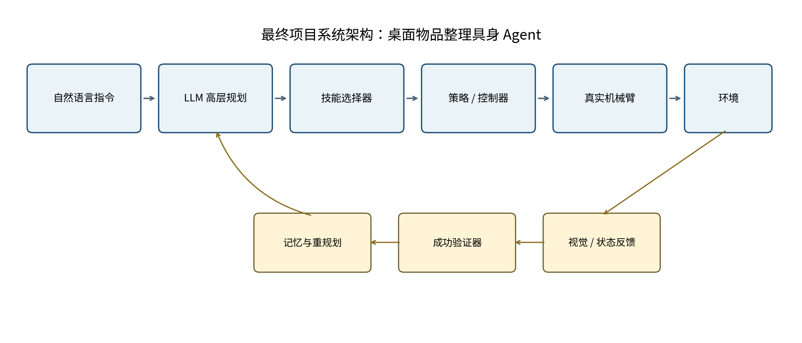
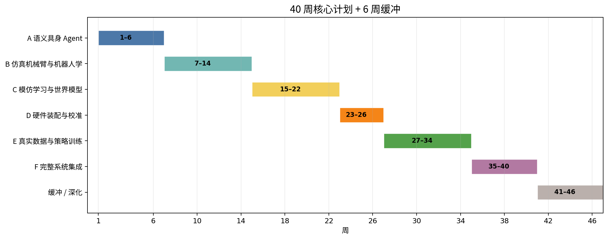

# 具身智能完整项目<br>业余开发计划

*从 LLM 软件 Agent 到真实机械臂闭环系统*



**适用背景：**具备 LLM / Agent 开发经验，暂无机器人和具身智能项目经验<br>**投入节奏：**工作日晚上 + 周末，每周约 8–12 小时<br>**核心周期：**40 周；建议额外保留 4–6 周缓冲<br>**文档版本：**v1.1｜2026 年 8 月（Scripted + ACT + SmolVLA 路线优化）

> **最终目标　**完成一个可重复演示、可量化评测的“桌面物品整理具身 Agent”：接收自然语言指令，观察真实桌面环境，规划子任务，调用机械臂技能完成抓取与放置，并能识别失败、重新规划和记录完整轨迹。

## 1. 执行摘要

**本计划以一个明确的最终项目为主线：**桌面物品整理具身 Agent。系统不是让 LLM 直接输出关节角，而是采用分层架构：LLM 负责语言理解、高层任务规划和异常处理；视觉与状态模块负责感知；经模仿学习训练的策略或确定性技能负责低层操作；控制器负责安全地驱动真实机械臂。

> **推荐周期　**按每周 8–12 小时计算，核心开发约 320–420 小时，对应 9–11 个月。若平均每周只有 6 小时，建议按 12–14 个月安排；若稳定达到 12–15 小时，可压缩至约 7–8 个月。

### 1.1 计划的核心原则

- 先仿真、后硬件：在机械臂仿真任务通过验收前，不采购高成本设备。
- 先结构化状态、后纯视觉：先验证 Agent loop 和控制闭环，再逐步移除“上帝视角”信息。
- 先模仿学习、后强化学习：真实硬件阶段优先使用遥操作演示和行为克隆/ACT，避免高风险在线试错。
- LLM 不进入高频控制环：LLM 只做秒级或任务级决策，10–50 Hz 的低层控制由策略与控制器完成。
- 模型按风险分层：Scripted policy 始终作为专家、基线与安全回退；ACT 是主学习策略；SmolVLA 仅在明确提升语言/视觉泛化时接入；TD-MPC2 只作为可选世界模型支线。
- 先复用、后微调、最后才从零训练：已有同机器人 checkpoint 先做固定评测；不足时优先小规模适配或微调，不为追求模型规模盲目采集和训练。
- 每阶段都有门禁：没有达到量化指标，就不扩展范围、不增加新框架、不购买下一批设备。

### 1.2 最终项目的验收定义

| **维度** | **最低验收标准** | **理想目标** |
| --- | --- | --- |
| 任务范围 | 至少 3 类桌面任务：指定物体抓取、放入指定容器、按属性分类 | 扩展到 5 类任务，并支持顺序约束 |
| 自然语言 | 能够将用户指令稳定映射为技能序列 | 支持指代、约束和简单纠错指令 |
| 真实执行 | 每类任务独立测试 20 次，总成功率 ≥70% | 总成功率 ≥85% |
| 失败恢复 | 能识别抓取失败、物体滑落或放置错误，并触发重试 | 失败恢复成功率 ≥60% |
| 安全 | 具备速度限制、工作区限制、急停和人工接管 | 连续运行 1 小时无危险碰撞 |
| 可复现性 | 数据、配置、模型、评测脚本和日志完整 | 一键运行演示与自动生成评测报告 |

### 1.3 明确不包含的范围

- 人形机器人、双足或四足运动控制
- 从零预训练大型 VLA 或视频世界模型
- 开放家庭环境中的通用机器人
- 高精度 SLAM、多房间自主导航
- 工业级安全认证和无人值守运行

## 2. 从软件 Agent 到具身 Agent：能力迁移

你已有的软件 Agent 经验并不会被推倒重来。高层架构几乎可以直接迁移，新增难点主要集中在三维空间、连续动作、物理反馈和真实数据。

| **现有经验** | **具身智能中的对应概念** | **需要新增的能力** |
| --- | --- | --- |
| Tool calling | 技能调用 / 动作接口 | 动作空间、参数边界与执行时序 |
| Agent loop | 感知—规划—行动—反馈闭环 | 部分可观测、实时反馈与状态估计 |
| Planner | 任务规划器 | 空间约束、动作前置条件与可达性 |
| Memory | 场景记忆 / 物体状态 | 坐标系、物体位姿和历史轨迹 |
| Verifier | 成功检测器 | 视觉验证、接触反馈和容错阈值 |
| Sandbox | 物理仿真器 | 碰撞、动力学、控制频率和 sim-to-real |
| Trace / logs | 机器人轨迹数据集 | 图像—状态—动作时间同步 |

### 2.1 必须补齐的最小知识栈

**机器人学基础：**坐标系、齐次变换、旋转矩阵/四元数、正逆运动学、关节空间与笛卡尔空间。

**控制与动作：**位置控制、速度控制、夹爪控制、控制频率、工作区和碰撞约束。

**机器人学习：**轨迹数据、模仿学习、行为克隆、ACT/扩散策略、离线评测。

**世界模型（可选）：**状态转移建模、多步预测误差、MPC/CEM 规划和不确定性；用于扩展研究，不作为主线交付门禁。

**真实系统工程：**标定、时间同步、摄像头、串口、急停、数据版本和故障排查。

## 3. 时间投入与工作节奏

### 3.1 标准每周节奏

| **时段** | **建议投入** | **适合任务** | **产出要求** |
| --- | --- | --- | --- |
| 工作日晚上 × 3 | 每次 60–90 分钟 | 阅读、单模块编码、日志分析、Prompt/配置修改 | 每次只关闭一个明确问题 |
| 周六 | 连续 3–4 小时 | 环境安装、硬件装配、数据采集、整体联调 | 完成一个可运行增量 |
| 周日 | 2–3 小时 | 批量评测、整理实验、写文档和下周计划 | 形成指标与结论 |

### 3.2 防止业余项目失控的规则

- 每周只设一个主里程碑；工作日晚间不做大规模环境迁移。
- 连续两周未完成里程碑时，先缩减范围，而不是增加投入承诺。
- 所有实验必须留下配置、随机种子、模型版本和结果摘要。
- 硬件问题超过两个晚上仍未定位时，回到最小控制脚本，不在完整 Agent 中盲调。
- 每 4 周安排一个“只整理、不加功能”的收敛周。

## 4. 总体路线与里程碑



> 时间轴说明：核心计划为 40 周；第 41–46 周用于硬件延期、数据补采、模型不稳定或演示整理。第 14 周只确认硬件采购意向与预算，第 22 周通过视觉策略门禁后才最终下单，避免在尚未验证兴趣和技术路径时过早投入。

| **阶段** | **周次** | **主要目标** | **核心交付物** | **门禁标准** |
| --- | --- | --- | --- | --- |
| A | 1–6 | AI2-THOR 语义具身 Agent | LLM planner、状态记忆、验证与评测 | 10 个任务成功率 ≥70% |
| B | 7–14 | 机器人学基础与仿真机械臂 | ManiSkill pick-and-place、轨迹记录 | 状态输入策略成功率 ≥80% |
| C | 15–22 | 视觉 ACT、可选 SmolVLA 与分层路由 | 视觉 ACT、模型适配报告、统一 fallback | 视觉 ACT ≥60%，世界模型不阻塞主线 |
| D | 23–26 | 真实硬件装配与标定 | 双臂遥操作、摄像头、急停和数据录制 | 连续遥操作 30 分钟稳定 |
| E | 27–34 | 真实数据采集与策略训练 | 真实数据集、策略部署、失败补采 | 3 类任务总成功率 ≥70% |
| F | 35–40 | LLM + 技能 + 验证完整集成 | 自然语言演示、自动评测、项目文档 | 完成最终验收定义 |
| 缓冲 | 41–46 | 稳定性与扩展 | 补采数据、性能优化、演示视频 | 不增加新主线，只解决缺口 |

## 5. 阶段 A：语义具身 Agent（第 1–6 周）

目标：在没有真实机械臂的情况下，先掌握具身 Agent 的状态闭环、部分可观测、任务验证和失败恢复。AI2-THOR 提供室内交互环境、可执行动作和物体状态，适合复用现有 LLM Agent 技术栈。[1]

| **周次** | **主题** | **任务** | **验收** |
| --- | --- | --- | --- |
| 第 1 周 | 环境跑通 | 安装 AI2-THOR；手动控制移动、旋转、抓取、放置；保存 RGB、metadata 和动作日志。 | Python 脚本可重复完成一条固定轨迹。 |
| 第 2 周 | 动作接口 | 设计统一 Action Schema、参数验证、执行结果标准化和最大步数限制。 | 动作调用层具备单元测试。 |
| 第 3 周 | LLM Agent loop | 实现 observation summarizer、planner、executor 和 trajectory logger。 | 模型能完成物体已可见的简单任务。 |
| 第 4 周 | 记忆与搜索 | 只向模型提供当前可见对象；维护已见物体、房间和持有状态；加入搜索策略。 | 可完成“先找再拿”的任务。 |
| 第 5 周 | 验证与恢复 | 实现重复动作检测、动作失败分类、子任务验证、重新规划。 | 至少处理 3 类常见失败。 |
| 第 6 周 | 批量评测 | 建立 10–20 条任务集；统计成功率、动作数、LLM 调用数、失败类型。 | 完成阶段报告和门禁评审。 |

### 阶段 A 实际进度（更新至 2026-08-06）

| 周次 | 状态 | 已完成 | 未完成 |
| --- | --- | --- | --- |
| 第 1 周 | ✅ 完成 | `first_trajectory.py`：固定动作序列、RGB 帧保存、JSONL 轨迹、summary.json | 无 |
| 第 2 周 | ✅ 完成 | `task_skills.py`：SkillExecutor 封装 scan/pick/place 技能，SkillResult 统一结果结构；`skill_registry.py`：技能参数 Schema 和验证；38 个单元测试覆盖 | 无 |
| 第 3 周 | ✅ 完成 | `observation.py`：Observation 数据结构 + summarize；`llm_planner.py`：LLM 后端接口 + 规则引擎回退；`executor.py`：AgentExecutor 主循环；`run_agent.py`：CLI 入口；`.env` 环境变量配置 | 无 |
| 第 4 周 | ✅ 完成 | L0/L1 捕获与召回；基于当前观察和已探索位姿的搜索；移动后全向目标探测；`--max-search-steps`；真实 AI2-THOR 验证可见目标和“先找再拿”场景，L0/L1/轨迹完整 | 无 |
| 第 5 周 | ✅ 完成 | 精确 TaskSpec 任务验证；统一动作/重试/搜索后处理；pick/place 二次验证；有限恢复；重复 scan 解环；`test_executor.py` 集成覆盖；默认 E2E 套件 3/3 通过 | 无 |
| 第 6 周 | ✅ 完成 | 12 条固定任务集；批量评测 CLI；可达视点与关闭容器搜索；放置换位与受控语义兜底；完整轨迹和失败报告；规则基线 10/12（83.3%）；真实 LLM 10/12（83.3%，39 次调用） | 无阻断项；a08 模拟器兼容性、a12 持有物体放置搜索作为后续非阻断缺口 |

**当前代码结构：**
- `first_trajectory.py` — 第 1 周：固定轨迹
- `pickup_nearest.py` — 第 1 周：抓取最近物体
- `pickup_and_place.py` — 第 1 周：抓取并放置（脚本化）
- `task_skills.py` — 第 2 周：技能封装（SkillExecutor, SkillResult）
- `skill_registry.py` — 第 2 周：技能注册表 + 参数验证
- `observation.py` — 第 3 周：观察数据结构 + 摘要
- `llm_planner.py` — 第 3 周：LLM 后端 + System Prompt + memory_context 注入
- `executor.py` — 第 3 周：Agent 主循环 + 记忆模块集成
- `run_agent.py` — 第 3 周：CLI 入口
- `task_parser.py` — 中文指令解析（脚本化版本）
- `run_task.py` — 脚本化任务执行
- `run_instruction.py` — 中文指令入口（脚本化版本）
- `memory_store.py` — 第 4 周：MemoryStore（L0/L1 JSONL 存储 + 关键词搜索）+ SearchStrategy
- `memory_capture.py` — 第 4 周：MemoryCapture（具身捕获适配器）
- `memory_recall.py` — 第 4 周：MemoryRecall（记忆召回）
- `env_config.py` — 本地 `.env` 安全加载（不覆盖 shell 环境）
- `run_e2e.py` — 确定性真实 AI2-THOR 验收与非零失败退出码
- `evaluation/stage_a_tasks.json` — 第 6 周：12 条版本化阶段 A 固定任务集
- `evaluation.py` — 第 6 周：任务加载校验、失败归类、指标聚合和 Markdown 报告
- `run_evaluation.py` — 第 6 周：独立 Controller 批量评测 CLI 与门禁退出码
- `requirements-llm.txt` — 第 6 周：真实 OpenAI 兼容后端的可选依赖
- `tests/test_skill_registry.py` — 22 个测试
- `tests/test_task_skills.py` — 16 个测试
- `tests/test_memory_store.py` — 24 个测试（MemoryStore + SearchStrategy）
- `tests/test_memory_capture.py` — 9 个测试（MemoryCapture）
- `tests/test_memory_recall.py` — 11 个测试（MemoryRecall）
- `action_monitor.py` — 第 5 周：ActionMonitor（重复动作检测）
- `failure_classifier.py` — 第 5 周：FailureClassifier（失败分类）
- `verifier.py` — 第 5 周：SubtaskVerifier（子任务验证）
- `replanner.py` — 第 5 周：Replanner（恢复策略）
- `tests/test_action_monitor.py` — 12 个测试
- `tests/test_failure_classifier.py` — 11 个测试
- `tests/test_verifier.py` — 13 个测试
- `tests/test_replanner.py` — 13 个测试
- `tests/test_executor.py` — Agent 主循环跨模块回归测试
- `tests/test_env_config.py` — `.env` 加载测试
- `tests/test_evaluation.py` — 第 6 周：任务集、指标、门禁、报告和异常隔离测试
- `tests/test_llm_planner.py` — 第 6 周：LLM 超时/重试和内置搜索契约 Prompt 测试
- `docs/week6/stage_a_gate_report.md` — 第 6 周：真实 AI2-THOR 阶段 A 门禁评审
- `requirements.txt` / `requirements-dev.txt` — 统一运行与测试环境依赖
- `se3.py` — 第 7 周：带坐标系语义的 SE(3) 构造、校验、组合、求逆和点变换
- `run_transform_demo.py` — 第 7 周：世界、基座、末端、相机和物体五坐标系变换链演示
- `tests/test_se3.py` — 第 7 周：坐标变换正常路径、数值约定和非法输入测试
- `kinematics.py` — 第 8 周：二维双连杆 FK、解析 IK、关节限位和 seed 选解
- `run_ik_demo.py` — 第 8 周：5 个固定目标的 IK→FK 回代验收
- `tests/test_kinematics.py` — 第 8 周：运动学双分支、奇异点、限位和失败路径测试
- `control.py` — 第 9 周：joint position、end-effector delta、gripper position 统一控制接口与动作限幅
- `run_control_demo.py` — 第 9 周：三模式固定控制序列、限幅与不可达安全拒绝演示
- `tests/test_control.py` — 第 9 周：控制契约、限幅、不变量和失败原子性测试
- `requirements-maniskill.txt` — 第 10 周：独立 ManiSkill 3、Torch 和 macOS Pinocchio 运行依赖
- `maniskill_intro.py` — 第 10 周：ManiSkill CPU 环境适配、观察/动作契约、两任务 scripted policy 和 episode runner
- `run_maniskill_demo.py` — 第 10 周：PickCube / PushCube 组合验收 CLI
- `tests/test_maniskill_intro.py` — 第 10 周：观察摘要、状态机、Gymnasium 生命周期和错误路径测试

**下一步：** 进入第 11 周：用现有 scripted expert 生成至少 200 条轻量、可重放的 ManiSkill 成功轨迹，记录 env state、action、seed 和 success；先抽检/回放 50 条，需要视觉训练时再批量补充 RGB observation。

> **阶段门禁 A**　**在结构化环境状态下，至少 10 个测试任务总体成功率达到 70%；能输出失败分类和完整轨迹。未达到时，不进入纯 RGB 感知，也不增加 Habitat、Isaac 或 ROS。

## 6. 阶段 B：机器人学基础与仿真机械臂（第 7–14 周）

目标：从“PickupObject 这类抽象动作”进入真实的连续控制问题。ManiSkill 提供 Gym/Gymnasium 接口、CPU/GPU 仿真和机器人操作任务，适合将策略学习与现有 Python 工程结合。[2]

| **周次** | **主题** | **任务** | **验收** |
| --- | --- | --- | --- |
| 第 7 周 | 坐标系 | 学习世界、基座、相机、末端和物体坐标系；完成 SE(3) 变换练习。 | 能解释并代码验证坐标变换链。 |
| 第 8 周 | 运动学 | 理解关节状态、末端位姿、正逆运动学和关节限位。 | 调用 IK 到达 5 个目标点。 |
| 第 9 周 | 控制接口 | 区分 joint position、end-effector delta、gripper action；加入动作限幅。 | 机械臂可稳定移动且不越界。 |
| 第 10 周 | ManiSkill 入门 | 运行 PickCube / PushCube；理解 observation、action、reward、episode。 | 手动或 scripted policy 完成任务。 |
| 第 11 周 | 专家轨迹 | 用 scripted expert 采集可重放的 env state、action、seed 和 success；先保存轻量原始轨迹，再按需 replay RGB。 | 至少 200 条成功状态轨迹；抽检/回放 50 条。 |
| 第 12 周 | 低维 BC | 用 state + action 训练小型 Behavior Cloning，验证数据、归一化、checkpoint 和 rollout 全链路。 | 独立评测成功率 ≥70%。 |
| 第 13 周 | ACT 主策略 | 复用同一数据训练 state ACT，理解 action chunk；与 BC、scripted policy 公平比较。 | ACT 成功率不低于 BC，目标 ≥75%。 |
| 第 14 周 | 稳定性与阶段评测 | 随机初始位姿、多随机种子、动作平滑和错误分析；保留 scripted fallback。 | ACT 状态输入成功率 ≥80%，安全违规为 0。 |

### 阶段 B 实际进度（更新至 2026-08-06）

| 周次 | 状态 | 已完成 | 未完成 |
| --- | --- | --- | --- |
| 第 7 周 | ✅ 完成 | NumPy 直接依赖；`RigidTransform` 的 RPY/矩阵构造、SE(3) 校验、组合、求逆与点变换；五坐标系变换链演示；31 项定向测试；完整回归 204 项通过 | 无 |
| 第 8 周 | ✅ 完成 | `JointLimit`、`IKSolution`、二维双连杆 FK/解析 IK、双分支与 seed 选解；5/5 固定目标到达，最大误差 `1.777e-16`；36 项定向测试；完整回归 240 项通过 | 无 |
| 第 9 周 | ✅ 完成 | 三类显式控制命令；关节/末端/夹爪硬限位与单步限幅；末端 IK 转换；不可达失败原子性；11 步演示覆盖 3 模式、9 次限幅和 1 次安全拒绝；26 项定向测试；完整回归 266 项通过 | 无 |
| 第 10 周 | ✅ 完成 | Python 3.11 独立 ManiSkill 3.0.1 环境；真实 observation/action/reward/episode 契约；PickCube/PushCube 状态机 scripted policy；seed 0 分别 20/14 步成功，seed 1 组合运行也通过；19 项定向测试；完整回归 285 项通过 | 无；macOS 运行需 Homebrew MoltenVK，已在本机安装并由入口自动定位 ICD |

> **采购决策点　**第 14 周通过低维 ACT 门禁后只形成采购意向和预算；第 22 周视觉 ACT、fallback 与固定评测均通过后再最终下单。还需确认你愿意持续投入，并具备稳定工作台和安全空间。

## 7. 阶段 C：视觉策略与模型适配（第 15–22 周）

目标：在已通过门禁的 ACT 主策略上加入视觉输入和语言条件，验证 SmolVLA 是否带来实际泛化收益，并把世界模型降为不阻塞主线的可选研究支线。LeRobot 提供真实机器人数据集、策略和硬件无关的 Python 接口，其数据集 v3 支持录制、加载、流式读取和图像增强。[3][4]

### 7.1 模型职责与进入门禁

| **模型/策略** | **主线定位** | **进入条件** | **停止条件** |
| --- | --- | --- | --- |
| Scripted policy | 必选：专家数据、确定性基线、安全回退 | 始终保留 | 不删除，只限制到已验证技能 |
| 低维 BC | 必选但轻量：验证数据与训练管线 | 第 11 周数据通过完整性检查 | 达到管线验收后不继续堆模型容量 |
| ACT | 主学习策略：仿真和真实 pick/place 执行器 | BC 全链路通过 | 连续两轮补采仍不优于 scripted 时回查数据/任务定义 |
| 已有同机器人策略 | 优先复用：零样本或少样本起点 | 输入、相机、state/action 维度可映射 | 20 次固定评测无明显成功案例则停止适配 |
| SmolVLA | 可选增强：语言约束、新物体和视觉泛化 | ACT 稳定，且具备 ≥50 条高质量视觉轨迹和可用云 GPU | 两轮实验未带来 ≥10 个百分点泛化提升则回退 ACT |
| TD-MPC2 / 小型 world model | 可选研究支线：理解预测与 MPC | 主线周任务已完成且仍有时间 | 不作为阶段 C、硬件采购或最终交付的阻塞门禁 |
| π0 / π0.5 | 当前不纳入 | 未来有 ≥24 GB GPU 和明确同形态数据再评估 | M4/RTX 4060 路线下不投入集成时间 |

| **周次** | **主题** | **任务** | **验收** |
| --- | --- | --- | --- |
| 第 15 周 | LeRobot 数据管线 | 转换 episode、timestamp、camera、state、action；实现 replay、检查和可视化。 | 可浏览任意轨迹并发现异常帧，字段缺失为 0。 |
| 第 16 周 | 视觉 ACT | 在 ACT 中加入单相机 RGB + proprioception；控制分辨率、batch 和显存。 | 完成端到端训练和 rollout，输出显存/时长记录。 |
| 第 17 周 | ACT 泛化 | 随机背景、照明和物体初始位姿；调节 chunk、归一化和动作平滑。 | 报告分布内/外成功率和失败分布。 |
| 第 18 周 | SmolVLA 适配探针 | 映射相机、state、action 和任务文本；先测试已有 checkpoint/推理服务，不从零训练。 | 完成 20 次固定零样本/少样本评测并作出 go/no-go 决策。 |
| 第 19 周 | SmolVLA 小规模微调（可选） | 仅在探针有正向信号时，用 ≥50 条高质量轨迹做 action head/小规模微调；否则继续优化 ACT。 | 与 ACT 同测试集比较，泛化提升目标 ≥10 个百分点。 |
| 第 20 周 | 分层策略路由 | 把 scripted、ACT、可选 SmolVLA 统一为技能执行器；定义选择、超时和 fallback。 | 同一技能接口可切换策略，失败可安全回退。 |
| 第 21 周 | 世界模型支线（可选） | 有余力时复用 TD-MPC2 或训练小型 dynamics + CEM；只做 PushCube 有限演示。 | 完成一个可复现实验；未完成不阻塞主线。 |
| 第 22 周 | 阶段评测与选型 | 比较 scripted、BC、ACT、可选 SmolVLA；冻结真实硬件阶段的主策略和回退策略。 | 形成模型卡、选型结论和固定评测报告。 |

> **阶段门禁 C　**视觉 ACT 在随机初始位置测试中成功率至少达到 60%，且 scripted fallback、安全约束和固定评测可用。SmolVLA 只有在同测试集带来明确泛化收益时才进入真实主线；世界模型实验不再作为采购和真实硬件阶段的阻塞条件。

## 8. 阶段 D：真实硬件装配与标定（第 23–26 周）

### 8.1 推荐硬件路线

默认选择 LeRobot 生态的 SO-101 双臂方案：一个 leader arm 用于遥操作，一个 follower arm 执行动作。官方文档提供物料清单、3D 打印、装配、校准和使用流程；LeRobot 的统一 Robot 接口能将观测、动作和策略训练连接起来。[3][5]

| **类别** | **必需配置** | **采购原则** | **备注** |
| --- | --- | --- | --- |
| 机械臂 | SO-101 follower + leader 各 1 套 | 以官方 BOM 和兼容电机为准；预留备件 | 双臂遥操作显著降低数据采集门槛 |
| 摄像头 | 至少 2 个 USB 摄像头 | 固定俯视/侧视；优先稳定帧率和可锁定曝光 | 后续可增加腕部视角 |
| 计算机 | Mac 负责开发；Linux + NVIDIA GPU 负责 CUDA 训练 | RTX 4060 8 GB 足够低维/小型视觉 ACT；SmolVLA 微调优先短租 ≥24 GB 云 GPU | 不为 π0/大 VLA 提前采购高端工作站 |
| 工作台 | 稳定桌面、固定底座、均匀照明 | 明确工作区边界，避免易碎物 | 背景尽量简单、可重复 |
| 安全与工具 | 急停/断电方式、扎带、螺丝工具、备用线材 | 先确保可人工接管，再开始自动运行 | 禁止无人值守执行 |
| 训练物体 | 软质方块、杯状容器、托盘、颜色块 | 尺寸、重量适中；避免尖锐和易碎物 | 先固定 3–5 种物体 |

> **预算方法　**不在计划阶段锁定固定价格。以 SO-101 官方 BOM 为基准，额外预留 20%–30% 用于 3D 打印、运费、备用舵机、线材、摄像头支架和返工。若现有计算机没有合适 GPU，优先短期租用云 GPU 完成训练，再决定是否采购工作站。

### 8.2 采购前检查表

- 仿真阶段 B、C 均通过门禁，并且愿意继续投入至少 4 个月。
- 有至少 80 cm × 60 cm 的稳定工作区，可长期保留设备。
- 可以使用 Linux 环境；若使用 Mac，已准备远程 Linux/GPU 方案。
- 明确设备来源、退换政策、3D 打印来源和备件周期。
- 能接受装配、走线、串口识别、校准和机械返工所需时间。

### 8.3 四周执行安排

| **周次** | **主题** | **任务** | **验收** |
| --- | --- | --- | --- |
| 第 23 周 | 到货核验与装配 | 按 BOM 清点；装配 leader/follower；记录每个电机 ID 和走线。 | 所有关节可单独识别。 |
| 第 24 周 | 标定与限位 | 完成零位、方向、关节范围；实现低速动作和一键断电。 | 无越界、抖动和异常发热。 |
| 第 25 周 | 遥操作 | leader 控制 follower；增加动作平滑、速率限制和日志。 | 连续遥操作 30 分钟稳定。 |
| 第 26 周 | 摄像头与录制 | 固定相机、锁定参数、同步录制图像/状态/动作；完成数据回放。 | 录制 20 条可复现 episode。 |

> **阶段门禁 D　**机械臂能够连续遥操作 30 分钟；所有动作有速度/范围限制；摄像头、关节状态和动作时间同步；发生异常时可以立即停机。未达到时禁止自动策略运行。

## 9. 阶段 E：真实数据采集与策略训练（第 27–34 周）

### 9.1 首批任务范围

- Pick-and-place：将单个方块放入托盘。
- Object sorting：根据颜色将两个物体放入对应区域。
- Container placement：将杯状物放到指定垫片或容器中。
- 失败恢复扩展：抓取失败后退回观察位并重试一次。

### 9.2 数据采集标准

- 每个基础任务先收集 50 条成功轨迹完成首轮训练；根据失败覆盖再扩到 100–200 条，质量优先于数量。
- 训练集、验证集、测试集按场景和物体初始位姿划分，避免相邻 episode 泄漏。
- 每条轨迹记录：任务文本、相机帧、关节状态、动作、时间戳、成功标记和人工备注。
- 失败轨迹单独保存并分类，不直接混入监督训练集。
- 每轮部署后按失败类型定向补采，而不是盲目增加同质数据。

| **周次** | **主题** | **任务** | **验收** |
| --- | --- | --- | --- |
| 第 27 周 | 任务与安全协议 | 固定物体、工作区、起始姿态、速度、终止条件和急停流程。 | 完成书面操作 SOP。 |
| 第 28 周 | 首批数据 | 收集 50 条单物体 pick-and-place 数据，进行质量抽检和回放；覆盖固定的位姿变化。 | 50 条高质量成功轨迹，关键字段缺失为 0。 |
| 第 29 周 | ACT 迁移 | 复用仿真数据管线训练/微调 ACT；已有同机器人 checkpoint 先评测再适配。 | 得到可部署 ACT checkpoint 和 scripted fallback。 |
| 第 30 周 | 首次部署 | 低速、人工看护下执行 20 次；记录失败视频和状态。 | 形成第一版失败分布。 |
| 第 31 周 | 针对性补采 | 针对抓取偏移、遮挡、放置抖动补采；只在失败覆盖不足时扩到 100–200 条。 | 主要失败类型占比明显下降。 |
| 第 32 周 | 第二任务 | 加入颜色分类或指定容器任务；若 ACT 语言条件不足，再启用 SmolVLA 适配探针。 | 第二项任务可由 ACT 或可选 SmolVLA 执行。 |
| 第 33 周 | 分层多任务策略 | 比较单任务 ACT、条件 ACT 和可选 SmolVLA；统一 scripted fallback。 | 冻结最终技能路由与模型组合。 |
| 第 34 周 | 真实评测 | 每项任务固定 20 次测试，统计成功率与置信区间。 | 3 类任务总体 ≥70%。 |

### 9.3 失败分类模板

| **类别** | **典型现象** | **优先排查** | **改进方式** |
| --- | --- | --- | --- |
| 感知 | 目标定位不稳定、受光照影响 | 相机曝光、视角、数据覆盖 | 锁定曝光、补充困难视角 |
| 策略 | 抓偏、动作抖动、过早闭合夹爪 | 动作归一化、chunk、训练数据 | 补采纠正轨迹、动作平滑 |
| 控制 | 延迟、关节越界、串口丢包 | 频率、限位、通信日志 | 降低速度、加 watchdog |
| 任务规划 | 选择错误技能或目标 | 技能前置条件和对象状态 | 结构化状态、参数验证 |
| 验证 | 失败未被发现或误判 | 视觉判据、阈值、观察位姿 | 增加验证视角和规则 |

> **阶段门禁 E　**至少 3 类真实任务，每类 20 次独立测试，总成功率达到 70%；能从日志中区分感知、策略、控制、规划和验证故障。只有稳定的底层技能才允许接入 LLM。

## 10. 阶段 F：完整具身 Agent 集成（第 35–40 周）

### 10.1 推荐系统分层

**LLM Task Planner：**把自然语言指令拆解为有限的技能序列；输出结构化 JSON，不输出连续关节动作。

**Skill Registry：**声明每个技能的参数、前置条件、终止条件、超时和失败码。

**Perception / State：**维护当前可见对象、目标属性、机械臂状态和任务历史。

**Policy Executor：**按技能加载 ACT 主策略或可选 SmolVLA，执行有限时长 action chunk；异常时中断并回退到 scripted policy。

**Verifier：**通过规则、状态或 VLM 判断子任务是否完成。

**Recovery Manager：**根据失败码选择重试、换观察位、重新抓取或终止。

**Safety Supervisor：**独立于 LLM，始终执行速度、工作区、超时和急停约束。

### 10.2 技能接口示例

```text
pick(object_id, grasp_hint=None) -> success | not_found | grasp_failed
place(target_zone) -> success | target_unreachable | object_dropped
move_to_observation_pose(pose_name) -> success | blocked
verify(predicate, timeout_s) -> true | false | uncertain
recover(error_code, context) -> next_skill | abort
```

| **周次** | **主题** | **任务** | **验收** |
| --- | --- | --- | --- |
| 第 35 周 | 技能封装 | 把真实策略封装为有超时、有错误码、有前置条件的技能 API。 | 可由脚本稳定组合调用。 |
| 第 36 周 | LLM Planner | 限定技能集合，设计 JSON schema、计划验证和参数校验。 | 自然语言到技能序列准确率 ≥90%。 |
| 第 37 周 | 任务验证 | 实现放置成功、夹爪持有、目标区域等判据；可选 VLM 辅助。 | 子任务结束可可靠判定。 |
| 第 38 周 | 记忆与恢复 | 记录对象状态、失败次数和当前计划；实现一次受控重试。 | 典型失败可恢复。 |
| 第 39 周 | 端到端评测 | 建立自然语言任务集，批量执行并输出日志、视频和指标。 | 完成最终指标表。 |
| 第 40 周 | 交付与展示 | 整理 README、架构图、数据说明、模型卡、演示视频和复盘。 | 第三方可按文档复现演示。 |

### 10.3 端到端任务示例

**用户指令：**“把红色方块放到左侧托盘，再把蓝色方块放到右侧托盘。”

1. Planner 解析约束并生成：observe → pick(red) → place(left) → verify → pick(blue) → place(right) → verify。
1. 每个 pick/place 由已训练策略执行，LLM 不参与高频控制。
1. 若抓取失败，Verifier 返回 grasp_failed，Recovery Manager 触发观察位重置并重试一次。
1. 超过最大重试次数后安全终止，输出失败原因和轨迹链接。

## 11. 技术栈与环境建议

| **层次** | **推荐工具** | **使用阶段** | **选择理由** |
| --- | --- | --- | --- |
| LLM Agent | Python、Pydantic/JSON Schema、自有 Agent 框架 | 全程 | 复用现有能力，保证动作参数可验证 |
| 语义仿真 | AI2-THOR | 阶段 A | 适合高层交互和室内任务闭环 [1] |
| 机械臂仿真 | ManiSkill / MuJoCo | 阶段 B–C | Gym 接口、操作任务和策略训练 [2] |
| 机器人学习 | PyTorch、LeRobot、ACT；SmolVLA 可选 | 阶段 C–F | 统一数据与硬件接口；轻量主策略优先，大模型按收益门禁接入 [3][4] |
| 真实硬件 | SO-101 leader/follower | 阶段 D–F | 低成本遥操作数据采集路线 [5] |
| 实验管理 | Git、DVC 或明确的数据版本目录、W&B/MLflow 可选 | 全程 | 保证模型、数据和指标可追溯 |
| ROS 2 | 可选，硬件驱动或多进程系统确有需要时再加入 | 阶段 F 之后 | 避免过早增加系统复杂度 |

### 11.1 操作系统建议

前期在 macOS 上可以完成 AI2-THOR、代码开发和部分 CPU 仿真。ManiSkill 官方文档说明 macOS 可运行 CPU simulation 和标准渲染，但目前不支持 GPU simulation，因此视觉策略训练和大规模仿真建议迁移到 Linux + NVIDIA GPU。[2]

ROS 2 不列为前置条件。若后续确实需要 ROS，优先选择硬件驱动明确支持的当前 LTS 版本。按 2026 年 7 月的官方发布信息，Lyrical Luth 是 LTS，支持期到 2031 年 5 月；但新发行版生态兼容性可能滞后，应以具体驱动和 LeRobot 集成测试为准。[6]

### 11.2 推荐仓库结构

```text
embodied-agent/
├── apps/                 # sim_agent、real_robot、demo
├── agents/               # planner、memory、verifier、recovery
├── skills/               # pick、place、observe 等统一接口
├── envs/                 # AI2-THOR / ManiSkill 适配器
├── policies/             # scripted、BC、ACT、可选 SmolVLA/TD-MPC2 配置
├── hardware/             # SO-101 控制、标定、相机和安全限制
├── datasets/             # 数据清单与版本元数据，不直接提交大文件
├── evaluation/           # 任务集、评测脚本、指标和报告
├── configs/              # 环境、任务、模型与设备配置
└── docs/                 # 架构、SOP、实验记录和复盘
```

## 12. 评测体系

### 12.1 核心指标

| **指标** | **计算方式** | **阶段目标** | **最终目标** |
| --- | --- | --- | --- |
| Task Success Rate | 成功 episode / 总 episode | 仿真 ≥80%，真实 ≥70% | 真实 ≥70%，理想 ≥85% |
| Subtask Success | 每个技能独立成功率 | 定位薄弱技能 | 关键技能 ≥85% |
| Recovery Rate | 失败后最终成功 / 可恢复失败 | 实现受控重试 | ≥50%，理想 ≥60% |
| Action Efficiency | 实际步数 / 参考步数 | 持续下降 | 无明显重复动作 |
| Safety Violation | 越界、急停、危险碰撞次数 | 必须为 0 | 必须为 0 |
| Planner Accuracy | 正确技能序列 / 指令数 | ≥90% | ≥95% |
| Dataset Quality | 成功率、同步错误、异常帧比例 | 异常 episode 可识别 | 关键字段缺失为 0 |

### 12.2 每次实验必须记录

- 代码提交哈希、环境依赖锁文件和硬件配置。
- 数据集版本、任务划分、相机参数和校准版本。
- 模型配置、checkpoint、训练时长和随机种子。
- 每个 episode 的任务文本、结果、失败码、视频和关键状态。
- 汇总指标与下一轮唯一要验证的假设。

## 13. 风险与应对

| **风险** | **早期信号** | **应对措施** | **触发降级方案** |
| --- | --- | --- | --- |
| 依赖与环境冲突 | 安装时间超过两晚、版本不断漂移 | 每个框架独立环境；锁定 Python 和依赖；保留最小示例 | 暂停新框架，只保留 AI2-THOR + ManiSkill + LeRobot |
| 硬件延期或损坏 | 缺件、舵机异常、返工频繁 | 采购备件；到货立即逐件测试；保存装配记录 | 延长仿真阶段，真实任务缩减为单物体 |
| 数据质量不足 | 训练 loss 下降但 rollout 失败 | 视频抽检；统一起始姿态；同步校验；失败分类 | 回到单任务、单物体、固定背景 |
| 计算资源不足 | 训练时间过长、OOM | 降低分辨率、batch、模型规模；云 GPU | 只训练 BC/ACT 小模型，不训练大 VLA |
| sim-to-real 落差 | 仿真成功、真实完全失败 | 真实数据优先；仿真仅做概念验证；加入扰动 | 取消仿真预训练，直接真实模仿学习 |
| 预训练模型不匹配 | action/state 维度不一致，或 20 次固定评测无明显成功案例 | 先做适配探针，记录输入输出映射和时延 | 停止继续微调，回到 ACT 主线 |
| LLM 规划不稳定 | 技能参数错误、重复计划 | JSON schema、有限技能集、计划静态检查 | 使用规则 planner 作为基线 |
| 安全风险 | 机械臂抖动、越界、发热 | 限速、工作区、watchdog、急停、人工看护 | 立即停机，退回单关节低速测试 |
| 业余时间中断 | 连续两周无有效产出 | 缩小任务、固定每周里程碑、保留实验日志 | 将最终范围缩减为 1–2 个稳定任务 |

## 14. 四个关键决策门

> **决策门 1｜第 6 周　**是否仍对“真实环境中的闭环 Agent”感兴趣。若 AI2-THOR 阶段已经明显缺乏兴趣，可以停止，无硬件沉没成本。

> **决策门 2｜第 14/22 周　**第 14 周确认低维策略与持续投入意愿，只形成采购意向；第 22 周视觉 ACT、scripted fallback 和固定评测通过后才启动 SO-101 采购。

> **决策门 3｜第 26 周　**硬件是否稳定、数据是否可录制、安全措施是否有效。未通过不运行学习策略。

> **决策门 4｜第 34 周　**底层技能是否达到 70% 真实成功率。只有通过后才接入 LLM，避免用高层推理掩盖低层不稳定。

## 15. 时间不足时的最小可行版本

若工作繁忙导致平均每周投入低于 6 小时，不建议放弃整个项目，而应把最终范围缩减为以下 MVP：

- 一个 SO-101 follower + leader 遥操作系统；一个固定摄像头。
- 单一任务：将一个方块放入固定托盘。
- 先用 50 条高质量轨迹训练 ACT；仅在失败覆盖不足时扩到 100–150 条。
- LLM 只负责将两三种自然语言表达映射到 pick_and_place 技能。
- Verifier 使用固定区域和夹爪状态规则，不引入复杂 VLM。
- 最终评测 20 次，成功率达到 70%，保存视频、日志和模型。

> **MVP 时间　**该缩减版本通常可在 6–8 个月内完成，仍然覆盖真实硬件、数据采集、策略训练、部署、LLM 规划和评测的完整闭环。

## 16. 第 1–2 周任务

### 第 1 周末必须完成

- 创建仓库和独立 Python 环境。
- 运行 AI2-THOR 官方最小示例。
- 手动执行 MoveAhead、Rotate、PickupObject 和 PutObject。
- 把每一步 RGB、metadata、action、success 保存到 JSONL。
- 写一页实验记录：遇到的问题、解决方案和下周目标。

### 第 2 周末必须完成

- 定义统一的 Observation、Action、StepResult 数据结构。
- 实现动作白名单、参数校验、最大步数和超时。
- 完成一个不用 LLM 的 scripted task。
- 为 scripted task 写自动验收测试。
- 确定第 3–6 周的 10 条评测任务。

## 17. 最终交付物清单

- ☐ 可运行的仿真 Agent 和真实机器人 Agent。
- ☐ 至少 3 个经过独立评测的真实机械臂技能。
- ☐ 真实机器人数据集及数据说明。
- ☐ 训练配置、模型 checkpoint 和模型卡。
- ☐ LLM Planner、Skill Registry、Verifier、Recovery Manager 和 Safety Supervisor。
- ☐ 自动化评测脚本、任务集和结果报告。
- ☐ 装配、标定、数据采集和急停 SOP。
- ☐ 系统架构图、演示视频、README 和完整复盘。

> **完成标准　**最终项目的价值不在于使用最多模型或框架，而在于从自然语言任务到真实物理执行形成可测量、可复现、可诊断的闭环。只要这个闭环稳定，即使任务范围较小，也已经是一项完整的具身智能工程。

## 18. 官方资料与参考入口

[\[1\] AI2-THOR：交互式具身 AI 环境与 iTHOR 文档](https://ai2thor.allenai.org/)

[\[2\] ManiSkill 3：Quickstart、任务与 macOS 安装说明](https://maniskill.readthedocs.io/en/latest/)

[\[3\] Hugging Face LeRobot：模型、数据集和真实机器人工具](https://huggingface.co/docs/lerobot/index)

[\[4\] LeRobotDataset v3.0：数据录制、加载、流式读取与增强](https://huggingface.co/docs/lerobot/lerobot-dataset-v3)

[\[5\] SO-101：物料、装配、校准和使用文档](https://huggingface.co/docs/lerobot/so101)

[\[6\] ROS 2 Releases：当前支持版本与 LTS 生命周期](https://docs.ros.org/en/rolling/Releases.html)

> **版本说明：**机器人软件生态更新较快。开始每个阶段前，应以官方文档检查当前安装方式、硬件兼容性和支持版本，并将实际版本写入项目的锁文件与实验记录。
